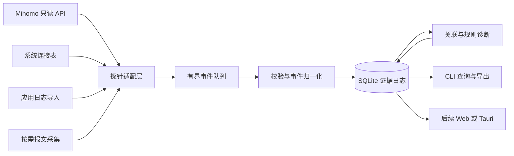

# Wiesler 架构规划

状态：设计约定，2026-10-29。网络功能尚未实现。

2026-10-30 实现更新：P1 已落地；另新增 `application.rs`、`observer.rs`、`sockets.rs` 和 `diagnostics.rs`，承载 DSH/Codex 日志、TCP 快照与可读诊断。实际范围、串行日志采样限制与未完成验收见[运行说明](running.md)及[本轮记录](implementation-20261030.md)。本文其余部分是原设计，包含尚未实施的后续模块。

## 1. 架构决策

采用单 Cargo 包起步，内部按采集、领域、存储和展示划分模块。事件契约稳定后再拆 workspace，避免初期跨 crate 调整成本。优先验证 Windows，核心逻辑保持与操作系统 API 解耦；Debian 后端按独立里程碑验收。



核心约束：监听与代理分离、采集与推断分离。Wiesler 不进入业务转发路径；进程退出、磁盘满或界面崩溃只能降低观测能力，不改变系统代理、路由或证书设置。

## 2. 计划目录与职责

以下为后续目录，当前仅落地 `src/main.rs`：

```text
src/
  main.rs                 CLI 参数和进程生命周期
  config.rs               配置校验、凭证读取、路径选择
  core/
    event.rs              版本化事件与证据引用
    connection.rs         快照状态机与连接会话
    correlator.rs         多源候选匹配及置信级别
    diagnosis.rs          可回放的诊断规则
  probes/
    mihomo.rs             HTTP/后续 WebSocket 适配
    sockets/windows.rs    Windows 连接表
    sockets/linux.rs      Debian 后端
    application.rs        显式选择的应用日志
    capture.rs            可选抓包后端
  store/
    sqlite.rs             单写入线程、事务、迁移
    export.rs             JSONL 与诊断报告
tests/
  fixtures/               脱敏快照、合成事件与报文
```

探针输出观测事实与健康状态，不直接下根因结论。领域层不依赖 reqwest、平台 API 或 UI。展示层读取存储与查询接口，不持有控制器密钥。SQLite 阻塞操作放在专用线程，不能阻塞 Tokio 的网络任务。

## 3. 采集与故障隔离

P1 只启用 `GET /version` 和 `GET /connections`。后续可按需接入 logs、traffic、proxies；具体字段以实际核心版本为准。请求端显式禁用系统代理和重定向，避免监控链路经过被监控代理，也避免凭证被带到不同地址。

初始支持范围限定回环 IP 上的 HTTP 控制器（127.0.0.1 或 ::1）；配置解析必须拒绝非回环地址、URL 用户信息及 URL 内的密钥。远程控制器要先加入经验证的 TLS 支持，再开放配置；不能把无 TLS 的 HTTP 能力默认为远程支持。

建议初始参数：1 秒采样、3 秒请求超时、失败后 1/2/4/8/16/30 秒上限退避并加抖动；慢请求不补发积压 tick。401/403 作为配置错误停止自动重试并提示修正；网络错误退避重试。所有参数为待负载实验调整的设计值。

每个探针独立任务，队列有界。队列满时记录累计丢弃数和起止时间，恢复后先发缺口事件，再重建快照基线；不能把跨缺口差分当作连续观察。终止时停止采集、排空队列、提交事务。存储失败时标记当前会话不完整并停止落盘流程，给出明确退出结果。

## 4. 统一事件契约

事件使用固定公共字段和按种类定义的载荷；扩展字段可以保留为 JSON，但核心逻辑不依赖任意字符串索引。

| 字段 | 设计含义 |
| --- | --- |
| schema_version | 存储/导出格式版本，用于迁移和回放 |
| event_id | 采集会话 ID 加本地递增序号，作为稳定证据引用 |
| session_id、source_id、source_epoch | 本次运行、探针实例及连续观测周期 |
| observed_at_utc、monotonic_offset | UTC 展示时间与进程内单调时间偏移 |
| source_timestamp | 数据源提供的时间，可空，保留精度和时区信息 |
| kind、payload | 事件种类与类型化内容 |
| connection_key | 数据源实例、观测周期、上游 ID 的组合，可空 |
| process | PID、名称、可取得时的进程启动时间；缺失保持未知 |
| tuple、interface | 协议、源/目标 IP 与端口、观测接口和方向 |
| evidence_ids | 推导事件所依赖的原始事件引用 |
| quality | 完整性、缺字段、采样间隔、丢包等质量标记 |

观察时间与源时间分开保存。跨源排序允许误差窗口；系统时钟调整不应让采样持续时间为负。只有满足同一时钟条件的证据才能严格比较先后。

基础事件：`ConnectionObserved`、`ConnectionUpdated`、`ConnectionDisappeared`、`ControllerUnavailable`、`ControllerRecovered`、`ObservationGap`、`CounterReset`。后续扩展 `TcpFinObserved`、`TcpResetObserved`、`DnsErrorObserved`、`ApplicationError`。`Observed` 不宣称捕获了实际建立瞬间。

## 5. 快照状态机

| 输入 | 状态变化 | 允许产生的结论 |
| --- | --- | --- |
| 首次有效快照 | 建立基线 | 当前看到这些连接，之前历史未知 |
| 连续有效快照出现新 ID | 添加连接 | 在前后两次采样之间首次观察到 |
| 连续有效快照缺少旧 ID | 标记消失 | 在采样窗口内不再可见，终止原因未知 |
| 超时、非成功状态、解析失败 | 保留旧基线但标为陈旧，打开缺口 | 采集异常，不能推导业务连接消失 |
| 缺口后恢复 | 新 source_epoch，重新建立基线 | 旧连接结束时间未知，新旧 ID 只能作为候选关联 |
| 同一 ID 的计数下降或 start 改变 | 标记计数重置/身份变化 | 不计算负速率，不直接拼接生命周期 |
| 上游明确重启或本程序重新启动 | 新会话或周期 | 不跨周期直接比较连接计数 |

有效快照须完成结构校验；不接受缺少 connections 的响应为“全部连接关闭”。ID 重复、关键字段类型错误产生解析异常。可选进程/域名为空时保持未知，目标显示可回退至 IP；不靠反向 DNS 自动生成额外查询。

字节增量只在同一连续周期内计算，使用实际采样间隔。上游计数只是代理观察到的流量，不能直接当作应用完整响应字节数。最后一次有效快照中的连接在程序停止时标为观察结束，不能补造关闭事件。

## 6. 跨层关联与诊断

关联结果保存候选集合、匹配字段、时间窗口和证据 ID，使用“直接证据 / 候选关联 / 无法关联”三级说明，不输出未经校准的概率数字。

- 同一来源的连接 ID 只在对应观测周期内作为稳定键。
- 系统套接字优先用协议、地址族、五元组及进程身份匹配；PID 和端口会复用，需要时间区间约束。
- 显式代理下应用连接的目标是回环代理端口；代理 API 的逻辑目标不同。匹配源端口、进程和入站信息，再记录映射依据。
- TUN、NAT、UDP 和代理复用允许多对多关系。没有可验证映射时，只展示并列时间线。
- 代理 chain 原样保存，未经适配器核实不假定首尾哪个条目就是物理出口节点。
- 应用日志是独立输入。没有导入日志时，不能生成 Codex 的 `Transport error` 事件。

诊断输出包括：所见现象、可定位的观测位置、证据列表、缺失证据与下一步检查。例：物理网卡看到某五元组的 RST，可以报告该处观察到重置；报文源地址不能单独证明真正发起方，更不能自动定位隧道内部哪条请求失败。

## 7. 持久化与数据生命周期

P1 规划 SQLite：`sessions` 记录版本和观测范围；`events` 保存版本化事件；`connections` 是可重建投影；`associations` 保存关联边与依据；`diagnoses` 记录规则版本和证据引用。对时间、连接键、来源建索引；不把凭证或完整控制器配置写入数据库。

原始证据先写入，再生成可重放投影与诊断。短批量事务、单写入线程和 WAL 支持同时查询；退出时完成提交。迁移前备份，迁移失败保留原库，不删除重建。导出通过一致性查询生成 JSONL，不能直接只复制一个仍在写入的数据库主文件。

默认只保存必要连接元数据，不保存请求正文、认证头或原始包。日志导入先做字段筛选；导出默认去掉完整进程路径及可能含隐私的规则载荷。原始包仅在用户选择接口、过滤条件、时长和容量后采集。

保留上限按实际事件率测量后配置。达到上限默认停止新增持久化并提示，清理既有数据须由用户明确选择范围；不以自动轮转名义静默删除用户证据。

## 8. 平台与后续界面

Windows 后端先封装 TCP owner PID 表的 IPv4/IPv6 调用，权限不足时保留连接并标记进程未知。UDP 所有者表、Linux /proc 或 netlink 路径作为后续适配，先核实平台 API，再承诺覆盖范围。

抓包以可选构建功能加入，Windows 的 Npcap 安装与分发条件、回环捕获，Debian 的 libpcap 与最小权限都要独立验证。默认 CLI 不依赖抓包驱动，也不自动申请管理员权限。

GUI 复用事件查询和导出。若增加本机 HTTP/WebSocket 服务，应只绑定回环、验证访问来源与鉴权，不向浏览器暴露代理密钥；先完成查询接口再选择 Tauri 或 Web 实现。

## 9. 待确定事项

后续实施前从实际环境核实：Mihomo 版本与模式（显式代理/TUN）、控制器地址、进程字段覆盖、Codex 日志格式与选择范围、典型连接规模。通过实测确定队列容量、批量写入大小和采样周期，不把当前建议参数当作已达到的性能指标。
